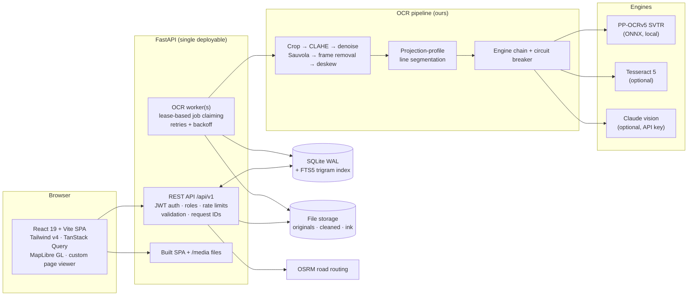
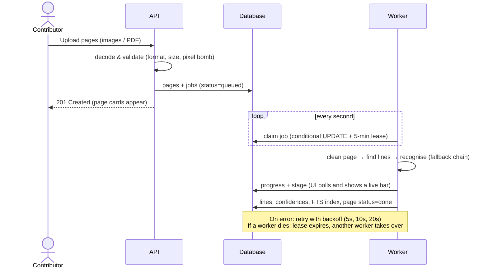
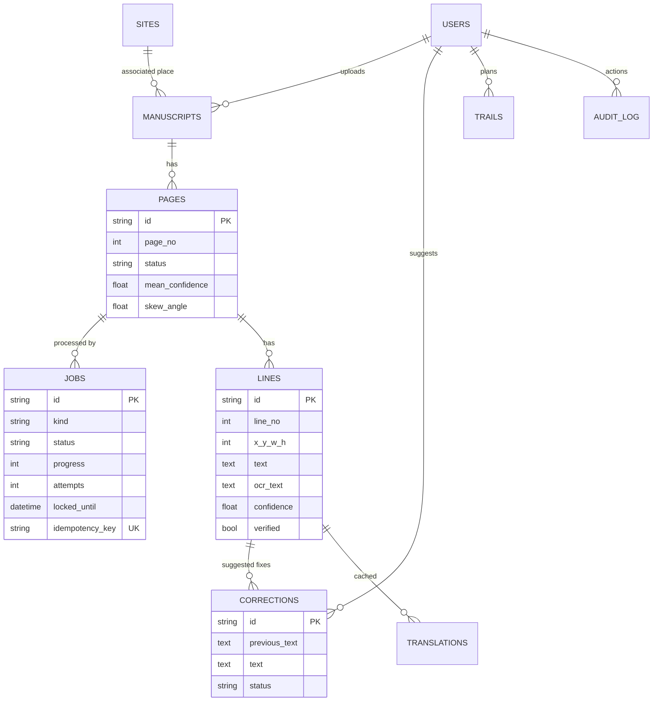

# LipiSetu — लिपि सेतु

**A bridge from old scripts to modern readers.** LipiSetu reads photographs of handwritten Indian manuscripts, lets people correct and verify the text together, makes every line searchable across scripts, and maps each manuscript to the heritage site it is connected to, with route planning to visit them.

Built for **HackCult '26 (IIT Gandhinagar) · Track 2: Culture & Digital Heritage**.

---

## What it does

| | Feature | How |
|---|---|---|
| 📜 | **Reads manuscripts** | Upload photos or a PDF. Each page is cleaned (crop, contrast, denoise, Sauvola binarisation, deskew), split into lines by our own projection-profile segmentation, and read by a PP-OCRv5 recogniser (SVTR, a transformer-style line recogniser) running on ONNX Runtime. |
| 🔍 | **Shows its confidence** | Every line gets a confidence score. Boxes on the page are green, amber or red, so people know exactly where to look. |
| ✍️ | **Human-in-the-loop correction** | Contributors suggest fixes next to the line image. Curators approve, adjust or reject with a character-level diff. Approved lines become *verified*. |
| 🔤 | **Cross-script reading** | One click switches any page between the original script, IAST romanisation, Devanagari and Gujarati. |
| 🔎 | **Search that tolerates OCR errors** | Type `dharma` and find धर्म. A trigram index over native text *and* romanised text, re-ranked by edit distance, finds lines even when the OCR dropped a letter. |
| 🗺️ | **Heritage map & trails** | 29 real heritage sites and manuscript libraries. "Near me" search, then a trail planner that orders the stops (nearest-neighbour + 2-opt) and fetches the road route from OSRM. |
| 🧪 | **OCR Lab** | We measure ourselves: real Sanskrit/Hindi text rendered on synthetic aged pages with known ground truth, scored by character error rate (CER) against two baselines, plus a text-coverage comparison on real folios. |
| 🗃️ | **Training dataset export** | Verified lines export as JSONL/CSV (line image URL + correct text), ready for fine-tuning a better recogniser, for example with Adaption's dataset and training tools. |
| 🛡️ | **Roles, audit, resilience** | Viewer / contributor / curator / admin roles, append-only audit log, database-backed job queue with leases, retries and exponential backoff, engine fallback with a circuit breaker, rate limiting, upload validation. |

## Measured results (OCR Lab)

Measured on this machine (CPU only), with the run shown in the app's OCR Lab:

| Approach | Synthetic pages: CER ↓ | Real folios: characters read ↑ |
|---|---|---|
| Off-the-shelf PP-OCRv5 (its own text detector) | 3.4% | 1,772 |
| Our segmentation, no page clean-up | 9.7% | — |
| **LipiSetu full pipeline** | **3.4%** | **3,467 (2.0× more)** |

* On clean, evenly spaced synthetic text, our pipeline **matches** the off-the-shelf model and cuts errors **2.8×** versus the same recogniser without our clean-up.
* On **real handwritten folios** (no word spaces, dense script, rubrication), the stock detector misses whole lines. LipiSetu reads **2× more text overall** and up to **10×** more on dense pages (e.g. the Advaita Viveka folio: 71 → 741 characters). Missing text can never be corrected; low-confidence text can, and that is what the review workflow is for.
* Skew is recovered to within 0.1° on test pages.
* Honest limits: handwritten Sanskrit without word spacing is hard for any recogniser. Real folios average about 70% line confidence, which is why every line is shown with its confidence and routed to human review.

## Architecture



### OCR job lifecycle



### Data model



Plus `line_fts` (FTS5, trigram tokenizer) holding each line in its own script and as ASCII romanisation.

### Why these choices

| Decision | Reason |
|---|---|
| **PP-OCRv5 (SVTR) via ONNX Runtime** instead of Surya | Surya now needs a separate vLLM/llama.cpp inference server. PP-OCRv5 has a Devanagari model, runs on any CPU in ~0.3 s per page, and is a transformer-style recogniser. |
| **Our own segmentation** instead of the stock text detector | Real manuscripts have no word spaces and dense lines. The stock detector loses whole lines (measured above). |
| **SQLite (WAL) + FTS5 trigram** | Zero-setup, one file, and trigram search works for every Indic script without a stemmer. The data layer uses SQLAlchemy and a search interface with a portable fallback, so moving to PostgreSQL is a configuration change plus an index swap (pg_trgm). |
| **Database-backed job queue** instead of Redis | One less moving part during a live demo. A conditional UPDATE gives atomic claims, a lease handles crashed workers, and scaling out means running more `python -m app.worker` processes. |
| **One deployable** (FastAPI serves the built SPA) | Same origin means no CORS in production, and one process to start for judges. |
| **HarfBuzz + FreeType for synthetic pages** | Pillow without libraqm misplaces Devanagari vowel signs, which would corrupt ground truth. |

## Run it

**Requirements:** Python 3.12, Node 20+ (tested on Windows 11 with Python 3.12.10 and Node 22.18).

### Windows, one time
```bat
setup.bat
```
This creates `backend\.venv`, installs packages, seeds demo data (running real OCR on 13 pages), and builds the frontend.

### Start
```bat
start.bat
```
Open **http://localhost:8000**.

### Manual / macOS / Linux
```bash
cd backend
python -m venv .venv && . .venv/bin/activate     # Windows: .venv\Scripts\activate
pip install -r requirements.txt
python -m scripts.seed                            # --reset to wipe and re-seed
cd ../frontend && npm install && npm run build && cd ../backend
uvicorn app.main:app --port 8000
```

Development with hot reload: `dev.bat` (API on :8000 with `--reload`, Vite on :5173 proxying `/api` and `/media`).

### Demo accounts

All seeded accounts use the password **`Lipi@2026`**. The login page also has one-click buttons. Change or remove these before any public deployment.

| Role | Email | Can |
|---|---|---|
| Admin | admin@lipisetu.in | everything, including user roles |
| Curator | curator@lipisetu.in | approve corrections, export dataset, manage sites |
| Contributor | contributor@lipisetu.in | upload, run OCR, suggest corrections, plan trails |
| Viewer | viewer@lipisetu.in | read, search, explore the map |

### Optional engines
* **Tesseract 5** (adds Gujarati and a dedicated Sanskrit model): install it with the `guj`, `san`, `hin` language data. It is detected automatically (or set `TESSERACT_CMD`).
* **Claude vision + translation:** set `ANTHROPIC_API_KEY` in `backend/.env`. The Translate button and the cloud OCR engine then switch on. Without a key, both explain what is needed instead of failing.

## Tests

```bash
cd backend
python -m pytest -q
```
24 tests cover:
* metrics, Unicode normalisation, skew recovery at four angles, and line segmentation on synthetic pages
* frame and blank-page handling, and a pipeline accuracy check against the raw baseline
* a regression test for the stock-detector baseline
* transliteration, cross-script query variants, haversine distances and 2-opt optimality
* end-to-end API flows: auth errors, role enforcement, upload → OCR job → page → search → correction → curator approval → export, the idempotent re-run, malicious upload rejection, nearby search and trail planning with router fallback, and a benchmark job

Every screen was also exercised manually in a browser: sign-in (good and bad password, stale session), manuscript creation with validation, upload and live OCR progress, the page viewer (zoom, line selection, script switching, editing), the review queue, search, the map, trail planning and detail, the OCR Lab, jobs, users, audit and theme switching.

## API

Interactive docs at **http://localhost:8000/api/docs** (OpenAPI). Main groups:

| Area | Endpoints |
|---|---|
| Auth | `POST /auth/register`, `/auth/login`, `/auth/refresh`, `GET/PATCH /auth/me`, `POST /auth/password` |
| Manuscripts | `GET/POST /manuscripts`, `GET/PATCH/DELETE /manuscripts/{id}`, `POST /manuscripts/{id}/pages` (multipart), `POST /manuscripts/{id}/ocr` |
| Pages | `GET /pages/{id}`, `GET /pages/{id}/transliterate?to=iast`, `POST /pages/{id}/ocr` (`Idempotency-Key` header), `DELETE /pages/{id}` |
| Lines | `GET /lines/{id}/image`, `GET /lines/{id}/transliterate`, `POST /lines/{id}/translate`, `POST/GET /lines/{id}/corrections` |
| Review | `GET /corrections?status=pending`, `GET /corrections/mine`, `POST /corrections/{id}/review` |
| Discover | `GET /search?q=`, `GET /sites`, `GET /sites/nearby`, `GET/POST/PATCH/DELETE /sites/{id}`, `POST/GET /trails`, `GET/DELETE /trails/{id}` |
| Lab & data | `GET/POST /lab/benchmarks`, `GET /export/summary`, `GET /export/training-data?format=jsonl\|csv` |
| Ops | `GET /jobs`, `GET /jobs/{id}`, `POST /jobs/{id}/retry`, `GET /stats/overview`, `GET /admin/users`, `PATCH /admin/users/{id}`, `GET /audit`, `GET /meta`, `GET /health`, `GET /ready` |

Errors always look like `{"error": {"code", "message", "request_id"}}`, and every response carries `X-Request-ID`.

## Security

* **Passwords and tokens:** Argon2id password hashing. JWT access and refresh tokens. Login takes the same time whether or not the email exists.
* **Roles:** checked on the server for every write. Uploaders and curators only can edit or delete a manuscript.
* **Uploads:** decoded, not trusted by extension. Format allow-list, 25 MB limit, pixel-bomb guard, re-encoded before storage, PDF page limit.
* **Abuse and logging:** per-IP rate limits (global, auth, upload, OCR, search), structured JSON logs with request IDs.
* **Headers and data access:** security headers (`nosniff`, `DENY` framing, referrer policy). SQL only through SQLAlchemy parameters. Storage paths are confined to the storage root.
* **Production:** set `JWT_SECRET`, remove the demo accounts, and serve over HTTPS.

## Scaling path

1. More throughput: run more `python -m app.worker` processes (set `EMBEDDED_WORKER=false` on the API).
2. Multi-instance: point `DATABASE_URL` at PostgreSQL, swap the FTS5 index for `pg_trgm`, and move rate limits to Redis behind the same interface.
3. Files: replace `LocalStorage` with an S3-compatible class (same `put/get/url` methods).
4. GPU: the recogniser is ONNX, so swapping in `onnxruntime-gpu` batches lines much faster.

## Project structure

```
lipisetu/
├── backend/
│   ├── app/
│   │   ├── main.py            app, middleware, error format, SPA + media serving
│   │   ├── models.py          SQLAlchemy models        ├── schemas.py   request validation
│   │   ├── security.py        Argon2, JWT, role checks ├── ratelimit.py sliding-window limiter
│   │   ├── api/               auth, manuscripts, pages, lines, corrections, discover, ops
│   │   ├── ocr/               preprocess, segment, pipeline, chain, postprocess, metrics, engines/
│   │   ├── services/          jobs, handlers, search, languages, geo, translate, storage, synthetic, textrender
│   │   └── worker.py          job loop (embedded thread or standalone process)
│   ├── scripts/seed.py        demo data with real OCR
│   ├── seed/                  sites.json, manuscripts/ (images + sources.json)
│   └── tests/                 24 pytest tests
├── frontend/src/
│   ├── pages/                 Dashboard, Manuscripts, ManuscriptDetail, PageViewer, Search, Review, MapPage, Trails, Lab, Dataset, Jobs, Users, Audit, Profile…
│   ├── components/            ui kit, Layout, ImageViewer, UploadPages, ManuscriptForm, Diff
│   └── lib/                   api client (token refresh), auth, theme, map, queries, formatting
├── setup.bat · start.bat · dev.bat
└── README.md
```

## Credits and licences

**Manuscript images** (Wikimedia Commons; licences as stated by the uploaders):

| Image | Author | Licence | Source |
|---|---|---|---|
| 12th-century Yogaśāstra of Hemacandra | Ms Sarah Welch | CC BY-SA 4.0 | [Commons](https://commons.wikimedia.org/wiki/File:12th-century_Yogasastra,_Hemachandra_Jainism,_Sanskrit,_1_mm_Devanagari_script.jpg) |
| 1674 CE Prayāga Snāna Vidhi (i) | Ms Sarah Welch | CC BY-SA 4.0 | [Commons](https://commons.wikimedia.org/wiki/File:1674_CE_Prayag_Snana_Vidhi,_Puranas_manuscript,_Sanskrit,_Devanagari_sample_i.jpg) |
| 1674 CE Prayāga Snāna Vidhi (ii) | Ms Sarah Welch | CC BY-SA 4.0 | [Commons](https://commons.wikimedia.org/wiki/File:1674_CE_Prayag_Snana_Vidhi,_Puranas_manuscript,_Sanskrit,_Devanagari_sample_ii.jpg) |
| 16th-century Jaiminīya Mīmāṃsā Sūtra Bhāṣya (Telugu script) | Ms Sarah Welch | CC BY-SA 4.0 | [Commons](https://commons.wikimedia.org/wiki/File:16th-century_Jaiminiya_Mimamsa_Sutra_Bhasya,_Sanskrit,_Telugu_script,_Andhra_Pradesh.jpg) |
| 16th-century Devī Māhātmya, Nārāyaṇī Stuti | Ms Sarah Welch | CC BY-SA 4.0 | [Commons](https://commons.wikimedia.org/wiki/File:16th-century,_Devi_Mahatmya_Narayani_Stutti,_Sanskrit,_Devanagari,_Det_Kongelige_Bibliotek,_Copenhagen_University,_Denmark.jpg) |
| 18th-century Yajurveda folio, Raghunath temple Jammu | Ms Sarah Welch | CC BY-SA 4.0 | [Commons](https://commons.wikimedia.org/wiki/File:18th-century_Yajurveda_manuscript_folio,_page_1,_Raghunath_temple_Jammu_archives.jpg) |
| Advaita Viveka manuscript | Aashadhar Bhatt | Public domain | [Commons](https://commons.wikimedia.org/wiki/File:Advaitvivek_manuscript.jpg) |
| Aitareya Brāhmaṇa, Schoenberg Center, Penn | Ms Sarah Welch | CC BY-SA 4.0 | [Commons](https://commons.wikimedia.org/wiki/File:Aitareya_brahmana,_page_1,_folio_3a,_Schoenberg_Center_manuscript,_Penn_Library.jpg) |
| Bhagavad Bhakti Ratnāvalī, leaf 5 of 70 | Ms Sarah Welch | CC BY-SA 4.0 | [Commons](https://commons.wikimedia.org/wiki/File:Bhagavad_bhakti_ratnavali,_Virancana_leaf_5_of_70,_18th_century_India,_Sanskrit,_Devanagari,_Det_Kongelige_Bibliotek,_Copenhagen_University,_Denmark.jpg) |
| 18th-century Bhāgavata Purāṇa | Unknown | Public domain | [Commons](https://commons.wikimedia.org/wiki/File:Bhagavata_Purana_manuscript,_18_century.jpg) |

**Other components and data:**
* **Fonts:** Noto Sans/Serif Devanagari and Noto Sans Gujarati (SIL Open Font License); Inter and Source Serif 4 (OFL).
* **OCR and maps:** PP-OCRv5 models (Apache 2.0, PaddlePaddle) via RapidOCR. OpenStreetMap data © OpenStreetMap contributors (ODbL), map tiles by OpenFreeMap, routing by the OSRM demo server.
* **Site data:** site coordinates are approximate and descriptions are short summaries. UNESCO inscription years are from whc.unesco.org.
* **Synthetic text:** classical Sanskrit verses (public domain), plus Hindi and Gujarati sentences written for this project.
